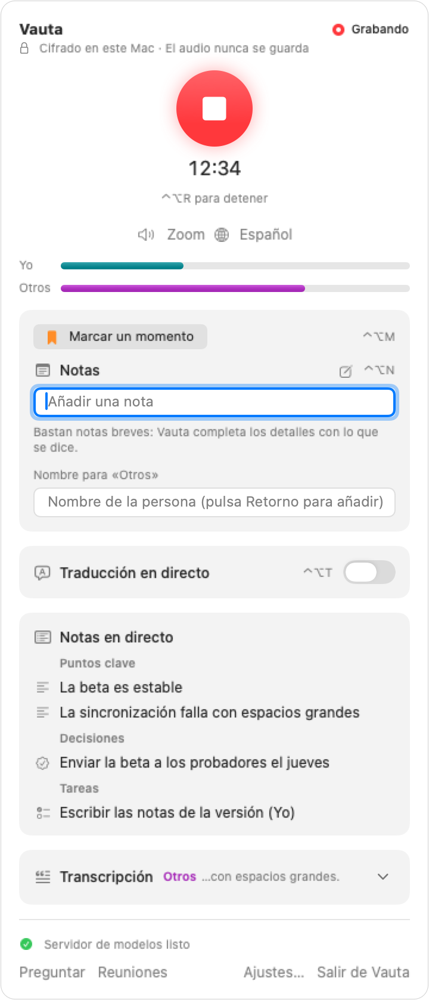
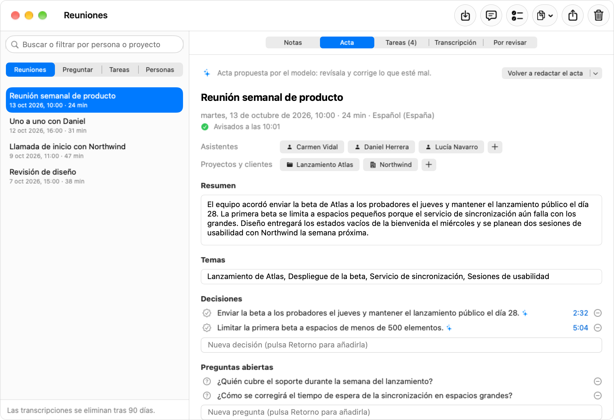
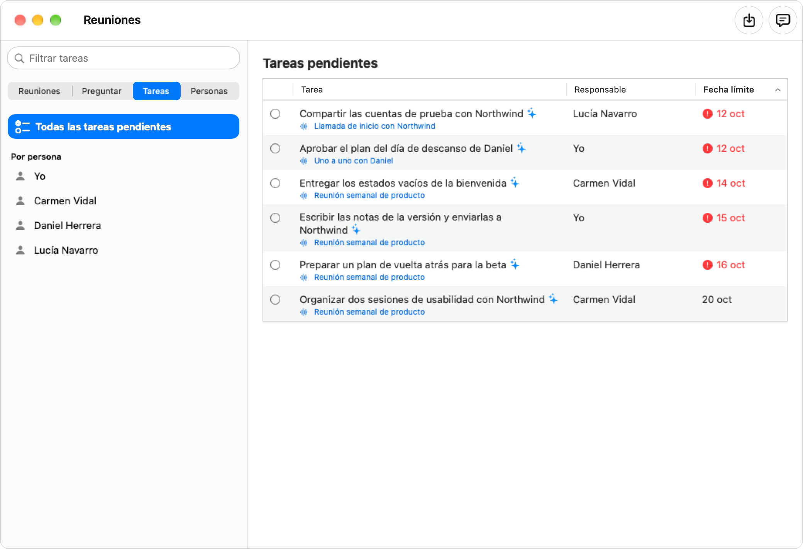
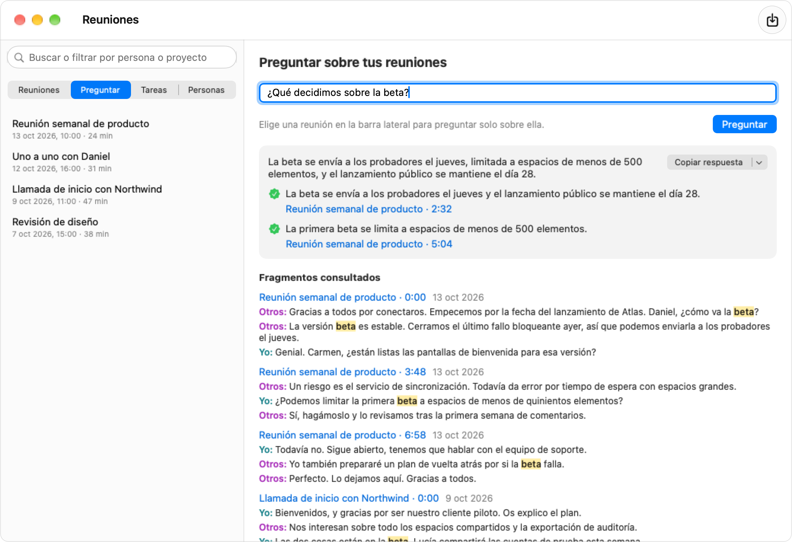
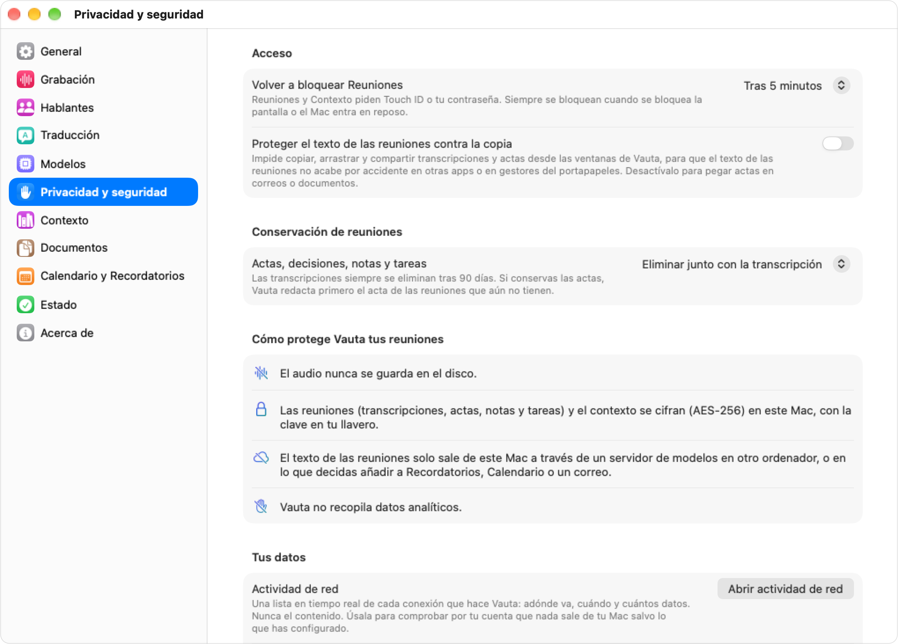

<p align="center">
  
</p>

<h1 align="center">Vauta</h1>

<p align="center">
  <strong>Tus reuniones, a buen recaudo en tu Mac.</strong><br>
  La memoria de tus reuniones para Mac que se queda en tu Mac y en tu propia red: cualquier app, también en persona, sin bots, sin cuentas, auditable. Vauta transcribe tus llamadas en el propio Mac y las convierte en actas, decisiones y tareas que puedes buscar y consultar.
</p>

<p align="center">
  <a href="LICENSE"></a>
  
  
  <a href="https://www.bestpractices.dev/projects/16025"></a>
</p>

<p align="center">
  <a href="https://vauta.vercel.app/es/"><strong>Web</strong></a> · <a href="README.md">English</a> · Español
</p>

---

Vauta es una app de la barra de menús de macOS. Escucha tu micrófono y la app que tiene la llamada, transcribe ambos en tu Mac con el reconocedor de voz de Apple y redacta el acta con el modelo que elijas: el modelo de Apple en el propio dispositivo, o un servidor de modelos que tú mismo ejecutas en este Mac o en tu red local.

No hay nube de Vauta, ni cuenta, ni ningún bot en tus llamadas. El audio nunca se guarda.

Cada afirmación de este README está respaldada por una prueba, un benchmark o un comando que puedes ejecutar tú mismo: consulta [docs/CLAIMS.md](docs/CLAIMS.md). La precisión medida (separación de hablantes, transcripción y comprobación de las citas de las actas, con método, hardware y límites) está en [docs/BENCHMARKS.md](docs/BENCHMARKS.md).

> Los documentos enlazados desde aquí están en inglés, salvo que se indique lo contrario.

## Índice

- [Funciones](#funciones)
- [Privacidad](#privacidad)
- [Capturas de pantalla](#capturas-de-pantalla)
- [Requisitos](#requisitos)
- [Instalar desde el código fuente](#instalar-desde-el-código-fuente)
- [Primeros pasos](#primeros-pasos)
- [Elegir un modelo](#elegir-un-modelo)
- [Idiomas](#idiomas)
- [Compatibilidad](#compatibilidad)
- [Preguntas frecuentes](#preguntas-frecuentes)
- [Solución de problemas](#solución-de-problemas)
- [Contribuir, seguridad y licencia](#contribuir-seguridad-y-licencia)

## Funciones

- **Ningún bot entra en tu llamada.** Vauta graba dos canales en tu Mac: tu micrófono como **Yo** y el audio de la llamada como **Otros**. Nadie más tiene que instalar ni aceptar nada.
- **Cualquier app de reuniones o navegador.** Captura Safari y otros navegadores WebKit, Chrome y otros navegadores Chromium, Firefox y otros navegadores Gecko, Zoom, Microsoft Teams, Slack, Discord, Webex y FaceTime (cuáles están verificadas en llamadas reales se indica en [Compatibilidad](#compatibilidad)). *Automático* sigue a la app que esté usando el micrófono, y *Todo el audio del sistema* sirve para todo lo demás. Vauta también puede proponerte transcribir cuando una app de reuniones empieza a usar el micrófono.
- **Cualquier idioma que admita Apple.** La transcripción usa los modelos de voz de Apple en el dispositivo. Cada reunión guarda su idioma, y el acta puede escribirse en el idioma de la reunión o en el que elijas.
- **Traducción en vivo.** Mientras grabas, un panel flotante de subtítulos muestra lo que dicen los demás participantes, traducido a tu idioma con la traducción de Apple en el dispositivo. Si tienes un servidor de modelos, este vuelve a traducir cada frase terminada con las anteriores como contexto y, si responde en menos de 4 segundos, sustituye el subtítulo en el sitio; si no, se queda la versión de Apple. Se queda sobre las apps de reuniones a pantalla completa, nunca roba el foco, y **⌃⌥T** lo activa o desactiva. Las frases terminadas se guardan cifradas junto con la transcripción.
- **Un recordatorio para avisar a los demás participantes.** Al empezar a grabar, el panel te ofrece un aviso breve para pegar en el chat de la reunión, escrito en el idioma de la reunión, con un botón Copiar y «Marcar como avisados» (Vauta guarda la fecha con la reunión; **Deshacer** la retira). Nunca envía nada ni impide grabar. En **Ajustes → Grabación** eliges cuándo aparece.
- **Actas con plantillas.** Resumen, temas, decisiones, tareas con responsable y fecha, y preguntas abiertas. Plantillas para reunión general, uno a uno, reunión diaria (stand-up), llamada con cliente o de ventas, entrevista, y clase o charla. Notas en directo, marcas y notas rápidas mientras grabas.
- **Preguntar, con citas.** Haz preguntas sobre todas tus reuniones o sobre una sola. Las respuestas citan los fragmentos de los que salen, y cada cita abre la transcripción en ese momento. La búsqueda por palabras siempre funciona; la búsqueda por significado es opcional.
- **Respuestas en directo a las preguntas de la reunión.** Mientras grabas, Vauta detecta las preguntas que se hacen en voz alta, tú o cualquier otra persona, y muestra en el panel una respuesta breve cuando la reunión hasta ese momento, tus reuniones anteriores o tus documentos pueden responderla, con la línea que cita cada afirmación. Funciona con el modelo integrado o un servidor de modelos (no con Apple Intelligence: véase más abajo), no roba el foco, no suena, nunca habla, no busca en la web y no envía nada más allá del modelo que elijas. La tarjeta muestra las afirmaciones, cada una con una cita de una línea cuyas palabras reproduce, y una respuesta con una afirmación que no coincide con ninguna cita no se muestra. Que la cita coincida no prueba que la afirmación sea correcta: el juez ciego encontró pocas respuestas mostradas correctas (2 % con Apple, 21 % con Gemma, en inglés) y, en la mayoría del resto, la pregunta repetida o la respuesta a algo que no era una pregunta, y afirmaciones sin respaldo en el 42 % (Apple) y el 21 % (Gemma) de las respuestas mostradas (véase más abajo). Se activa, o se elige dónde busca, en **Ajustes → Grabación → Respuestas en directo**. Empieza **desactivada** y **no se ofrece con Apple Intelligence**: se midió en 39 reuniones públicas y solo el 2 % de las respuestas que mostró se juzgaron correctas en inglés, así que con el modelo del dispositivo de Apple Ajustes no muestra el interruptor, solo una nota que dice que las respuestas en directo necesitan el modelo integrado o un servidor de modelos, y una grabación nunca busca preguntas, aunque lo hubieras activado antes. El modelo integrado tampoco alcanzó los umbrales y un servidor de modelos aún no se ha medido (véase [LANGUAGE_MODEL.md](docs/LANGUAGE_MODEL.md#live-answers-to-questions-heard-in-the-meeting), en inglés); con ellos, si quieres probarla, la activas en Ajustes.
- **Personas y tareas.** Vauta construye un grafo de las personas, proyectos, clientes y temas de tus reuniones, con una lista de tareas pendientes. Un glosario y las reuniones periódicas le ayudan a reconocer nombres y términos. Si le das permiso, puede tomar el título y los asistentes de tu calendario.
- **Un resumen previo antes de cada reunión.** Con Calendario activado, Vauta puede preparar una página breve para la reunión que va a empezar: quién viene, qué dejó pendiente la última reunión con ellos (decisiones, tareas y preguntas abiertas), reuniones relacionadas, tus documentos y notas, y recordatorios relacionados. Se prepara en este Mac con lo que Vauta ya tiene, y cada línea de los datos de Vauta abre su origen (las líneas de la invitación son texto sin enlace). Una notificación unos minutos antes (Desactivada, 5, 10, 15 o 30) solo avisa de que hay un resumen listo. También aparece como tarjeta en el panel de la barra de menús, como **Próximas** en Reuniones y como pestaña **Resumen previo** de una reunión grabada con él. Los recordatorios (solo las listas que elijas) y una carpeta de notas exportadas de Notas (macOS 27; en macOS 26 sin confirmar) son opcionales; el resumen previo nunca escribe en Calendario, Recordatorios ni Notas. El resumen previo se activa al activar Calendario, con la notificación 10 minutos antes (en Ajustes → Calendario y recordatorios se desactiva o se cambia el aviso), y lo ordenan las palabras clave, no el modelo de búsqueda. Una agenda sugerida por un modelo queda desactivada: el modelo de Apple y el integrado no superaron la prueba de utilidad (41,7 % y 54,1 % frente a 70 %) y la del servidor de modelos no se midió (ver docs/BRIEF.md); no se afirma ninguna comparación con otros productos.
- **Después de una reunión, decides tú.** **Seguimiento…** (⇧⌘U) convierte las tareas abiertas de una reunión en recordatorios de una lista que eliges, la próxima reunión acordada en un evento de Calendario (o en un archivo que abre Calendario, cuando Calendario no está activado). Cada elemento lo confirmas tú: nada viene marcado de antemano, nada se escribe hasta que pulsas Añadir, un editor muestra exactamente qué se escribirá y dónde, Deshacer solo quita lo que Vauta añadió y una tarea no se añade dos veces salvo que elijas **Añadir de todos modos** (Vauta guarda un registro de lo que añadió y revisa los títulos de la única lista a la que añade; un archivo entregado a Calendario solo se comprueba con el registro). Una tarjeta del panel de la barra de menús ofrece revisar una reunión cuando su acta está lista. Recordatorios pide acceso la primera vez que pulsas Añadir; Calendario nunca: sin acceso, Calendario abre un archivo y pregunta dónde añadirlo. Consulta [docs/ACTIONS.md](docs/ACTIONS.md) (en inglés). Vauta también busca en la transcripción las reuniones de seguimiento acordadas y ofrece como máximo 2 por reunión para que las confirmes (en una prueba evaluada de 15 reuniones cuyas actas se hicieron con la nueva extracción, que la aplicación aún no usa; las actas de la aplicación no se midieron, y con ellas el detector ignora las tareas «sin confirmar». Con ese límite, listó 26 de las 30 reuniones esperadas que podía listar; las 26 eran frases insertadas en las transcripciones de prueba, todas eran menciones reales de una reunión de seguimiento (el límite inferior de esa precisión, 0,87, queda por debajo del umbral de 0,90) y todos los días eran correctos, pero 2 de las 26 no traían la hora que sí se dijo; sobre las 103 reuniones esperadas encontró 26, y no encontró ninguna de las 2 menciones de la conversación corriente); siempre puedes añadir una a mano (**Nuevo evento…**). El borrador de correo de seguimiento no está disponible en esta versión: en la misma prueba ningún borrador cumplió la condición de cero errores factuales (consulta [docs/BENCHMARKS.md](docs/BENCHMARKS.md#post-meeting-actions)). Una tabla sencilla de funciones está en [docs/ACTIONS.md](docs/ACTIONS.md#feature-table). Enlazar una tarea o una decisión con la misma de una reunión anterior está construido pero **desactivado**: en una prueba evaluada no alcanzó los umbrales de precisión y de exhaustividad ni con el modelo de Apple ni con el integrado, así que Vauta no sugiere nada de ese tipo (consulta [docs/BENCHMARKS.md](docs/BENCHMARKS.md#post-meeting-actions-part-b-links), en inglés).
- **Exportar e importar.** Exporta una reunión como Markdown, texto sin formato, PDF, subtítulos SRT o WebVTT, o JSON, con la traducción guardada si quieres. En una reunión con hablantes, las exportaciones nombran quién dijo cada línea (una etiqueta dudosa dice «(no seguro)»); nunca contienen datos de voz. Copia el acta, o una respuesta con sus fuentes. Importa una grabación de audio o vídeo como reunión nueva.
- **Cifrado en reposo.** El almacén de reuniones se cifra con AES-256-GCM y la clave se guarda en tu Llavero. La ventana Reuniones se bloquea tras Touch ID o tu contraseña. Por defecto, las reuniones se borran a los 90 días. Puedes conservar las actas y lo que Vauta ha aprendido de ellas durante uno o dos años, o sin límite; las transcripciones se siguen borrando a los 90 días.
- **El modelo que tú elijas.** Apple Intelligence en este Mac, sin configurar nada, el modelo integrado opcional (Gemma 4 E4B de Google, en Macs con 16 GB o más) o un servidor de modelos compatible con OpenAI como LM Studio, Ollama, llama.cpp, MLX, vLLM, Jan o LocalAI. Los servidores que corren en este Mac se detectan solos.
- **Auditable.** Ajustes → Privacidad y seguridad → **Abrir actividad de red** muestra cada conexión que hace Vauta (adónde, cuándo y cuántos datos, nunca el contenido), para que compruebes tú mismo lo que promete ([cómo se respalda cada afirmación](docs/CLAIMS.md#privacy-and-security), en inglés).
- **Nativa.** Swift y SwiftUI, solo frameworks de Apple y el SQLite del sistema. Solo un paquete de terceros: MLX (MIT), que ejecuta en la GPU el modelo de búsqueda opcional y el modelo integrado opcional. Nada más. Los dos modelos de separación de voces incluidos son pesos, no código; consulta [NOTICE](NOTICE).

## Privacidad

Vauta está hecha para que tus reuniones sigan siendo tuyas.

- **El audio nunca se escribe en disco.** Se transcribe en memoria según llega y se descarta.
- **La transcripción se hace en tu Mac** con el framework de voz de Apple.
- **Sin telemetría**, sin analítica ni informes de fallos, y sin cuenta.
- **El único tráfico de red** es:
  - **El servidor de modelos que elijas**, si eliges uno. A un servidor *en este Mac* solo se accede por una dirección de loopback. A un servidor *en tu red* solo se accede por HTTPS (TLS 1.3) y solo en una dirección privada (como `192.168.x.x`, `10.x.x.x` o una dirección de Tailscale) o un nombre local (como `*.local`). Puedes confiar en él mediante tu propia autoridad de certificación y fijar su clave. Vauta no usa proxy ni sigue redirecciones, y se niega a enviar nada a una dirección de internet.
  - **Buscar servidores en este Mac**: cuando buscas servidores durante la configuración inicial o en Ajustes, Vauta prueba los puertos habituales solo en `127.0.0.1` (1234, 11434, 8080, 8000 y 1337).
  - **Las descargas de modelos de Apple.** macOS descarga de Apple los modelos de voz, los idiomas de traducción y los recursos de la búsqueda en el dispositivo. Vauta no los descarga por su cuenta.
  - **Los modelos opcionales de Hugging Face**, solo cuando pulsas **Descargar**: el modelo de búsqueda (EmbeddingGemma 2) y el modelo integrado (Gemma 4 E4B), cada uno de una revisión fija, con peticiones simples que no llevan cuenta, token ni nada sobre ti o tus reuniones. Nunca al abrir la app ni en segundo plano.
- **Con Apple Intelligence** para las actas y la búsqueda, el texto de las reuniones nunca sale de tu Mac.
- Vauta nunca acepta conexiones entrantes. Se ejecuta en el App Sandbox con el runtime reforzado, y solo puede leer o escribir los archivos que elijas en un diálogo de Abrir o Guardar.

En [PRIVACY.md](PRIVACY.md) tienes todo lo que Vauta guarda y dónde, y en [SECURITY.md](SECURITY.md), el modelo de amenazas (ambos en inglés).

### Compruébalo tú mismo

No tienes que fiarte de nuestra palabra.

- **Actividad de red.** Abre Ajustes → Privacidad y seguridad → **Abrir actividad de red** para ver cada conexión que Vauta ha hecho desde que se abrió: la hora, la finalidad (actas, notas en directo, Preguntar, búsqueda por significado, traducción, búsqueda de servidores, prueba de conexión o comprobación de estado), el host y el puerto de destino, el método y la ruta, el tamaño aproximado de lo enviado y recibido (solo el cuerpo, sin cabeceras) y el resultado. Las sondas idénticas repetidas a tu Mac (como la guía de configuración buscando un servidor) aparecen como una sola fila con un contador y la hora de la última, y una solicitud que las reglas de Vauta rechazaron antes de enviarla aparece como **Bloqueada** (el motivo está en su ayuda emergente, nunca el contenido) y se nombra bajo el resumen. Una sonda de búsqueda que no encuentra ningún servidor se muestra como «Nada en ejecución», no como un fallo. Un resumen arriba cuenta los destinos, por ejemplo «Solo 2 destinos, todos en tu Mac o en tu red local». La lista nunca guarda contenido, instrucciones, cabeceras, claves ni cadenas de consulta, y vive solo en memoria (las últimas 1.000 solicitudes de esta sesión). Puedes filtrarla (el recuento pasa a decir «N de M solicitudes»), borrarla o guardarla con **Exportar JSON…**. Con una ventana de Vauta abierta, **Ventana → Actividad de red** (⌥⌘N) también la abre.
- **Sin atajos.** Cada solicitud pasa por un único punto de código auditado, y una prueba falla si cualquier otro archivo del código abre una conexión. Puedes leerlo: `Sources/VautaCore/Network/AuditedSession.swift`.
- **Lo que no puede mostrar.** Las descargas que hace el propio macOS (idiomas de reconocimiento de voz y de traducción, archivos del modelo de Apple Intelligence) no son conexiones de Vauta, así que no aparecen.
- **Herramientas independientes.** Para comprobarlo desde fuera de Vauta, usa un monitor de red de confianza, como [Little Snitch](https://obdev.at/products/littlesnitch/) o [LuLu](https://objective-see.org/products/lulu.html), y mira a qué se conecta Vauta: solo deberías ver tu servidor de modelos (o `127.0.0.1`). En Terminal, `lsof -nP -i -a -c Vauta` lista las conexiones abiertas de Vauta en ese momento.

## Capturas de pantalla

Las capturas muestran reuniones de ejemplo inventadas, en modo claro u oscuro según el tema de GitHub.

<p align="center">
  <picture>
    <source media="(prefers-color-scheme: dark)" srcset="docs/assets/screenshots/menubar-panel-recording-es-dark.png">
    
  </picture>
</p>

<p align="center">
  <picture>
    <source media="(prefers-color-scheme: dark)" srcset="docs/assets/screenshots/meetings-minutes-es-dark.png">
    
  </picture>
</p>

<p align="center">
  <picture>
    <source media="(prefers-color-scheme: dark)" srcset="docs/assets/screenshots/tasks-es-dark.png">
    
  </picture>
</p>

<p align="center">
  <picture>
    <source media="(prefers-color-scheme: dark)" srcset="docs/assets/screenshots/ask-es-dark.png">
    
  </picture>
</p>

<p align="center">
  <picture>
    <source media="(prefers-color-scheme: dark)" srcset="docs/assets/screenshots/settings-privacy-es-dark.png">
    
  </picture>
</p>


Vauta tiene tres sitios que vas a usar:

| Dónde | Para qué |
|---|---|
| **Panel de la barra de menús** | Empezar y parar la grabación, ver los dos niveles de audio, elegir la fuente de audio y el idioma, añadir marcas y notas rápidas, leer las notas en directo. |
| **Ventana Reuniones** | Leer actas y transcripciones, editarlas, exportarlas, y cambiar entre Reuniones, Preguntar, Tareas y Personas (⌘1–⌘4). |
| **Ajustes** | General, Grabación, Modelos, Privacidad y seguridad, Contexto, Calendario y Recordatorios, Estado y Acerca de. |

## Requisitos

- Un Mac con **Apple silicon**.
- **macOS 26** o posterior.
- Espacio libre en disco para el modelo de voz de Apple de cada idioma que transcribas. macOS descarga cada uno una sola vez.
- Para redactar actas, una de estas dos opciones:
  - **Apple Intelligence** activado, en un Mac y un idioma compatibles, o
  - un **servidor de modelos compatible con OpenAI** en este Mac o en otro ordenador de tu red. Consulta [docs/MODEL_SERVERS.md](docs/MODEL_SERVERS.md).

La transcripción funciona sin ninguna de las dos. Sin modelo tendrás transcripciones, pero no actas ni respuestas.

## Instalar desde el código fuente

Vauta se distribuye solo como código fuente. No hay descarga, ni instalador, ni paquete de Homebrew: clonas el repositorio y compilas Vauta en tu propio Mac. Así también sabes qué ejecutas (consulta [SECURITY.md](SECURITY.md#verifying-what-you-run)).

Requisitos, además de los anteriores: Git y las **Command Line Tools** de Apple con el SDK de macOS 27 (Swift 6.4), que se instalan con `xcode-select --install`. No hace falta Xcode. Una compilación hecha en tu propio Mac no está en cuarentena, así que Gatekeeper no la bloquea.

```sh
git clone https://github.com/MaquinaTech/Vauta.git
cd Vauta

# Recomendado, una sola vez: crea una identidad de firma local gratuita en su propio llavero bloqueado (pide contraseñas).
./scripts/setup-signing.sh

# Compila, instala en ~/Applications y abre Vauta.
./scripts/install.sh
```

Vauta aparece en la barra de menús. Mientras una de sus ventanas (Reuniones, Ajustes, Configuración inicial) está abierta, también aparece en el Dock y en ⌘Tab, con su barra de menús completa; al cerrar la última vuelve a estar solo en la barra de menús.

**Por qué `setup-signing.sh`.** Crea un certificado autofirmado que solo existe en tu Mac, en un llavero propio protegido por su propia contraseña. Con esa firma estable, macOS reconoce cada recompilación como la misma app, así que conserva los permisos de Vauta (micrófono, audio del sistema, Calendario y Recordatorios) y su acceso al Llavero entre actualizaciones. No cuesta nada y no necesita una cuenta de Apple Developer.

**Alternativa rápida: firma ad hoc.** Para saltarte la configuración de la firma:

```sh
VAUTA_ALLOW_ADHOC=1 ./scripts/install.sh
```

A cambio, cada recompilación le parece a macOS una app nueva, así que vuelve a pedir los permisos tras cada actualización.

La primera vez que se abre la app, macOS pide la contraseña del Llavero para «Vauta». Elige **Permitir siempre**. Si ese aviso aparece en cualquier otro momento, elige **Denegar**.

**Permisos.** Durante la configuración inicial macOS pide el **micrófono** (tu voz), el **audio del sistema** (los demás participantes de la llamada) y, si activas esas funciones, **Calendario** (títulos y asistentes de las reuniones), **Recordatorios** (para enviarles las tareas) y notificaciones. Vauta también pide acceso a tu **red local** si lo apuntas a un servidor de modelos en otro ordenador. Puedes cambiar cada uno después en Ajustes del Sistema → Privacidad y seguridad.

**Actualizar.** Ejecuta el script de actualización: instala la versión más reciente solo si su etiqueta está firmada con la clave del mantenedor, muestra las notas de la versión y pregunta antes. Vauta se cierra con orden, se reemplaza y se vuelve a abrir:

```sh
cd Vauta
./scripts/update.sh                         # con la identidad de firma local, en tu propio Terminal
VAUTA_ALLOW_ADHOC=1 ./scripts/update.sh     # con la firma ad hoc
```

Comprueba la clave con el `.github/allowed_signers` que ya tienes (y con la huella de [SECURITY.md](SECURITY.md#verifying-what-you-run), en inglés), no instala una versión más antigua que la instalada, ejecuta las pruebas y deja esta carpeta en la etiqueta de la versión (`git switch main` vuelve a la rama). Desde una copia de la 0.9.3 o anterior, ejecuta una vez `git checkout main && git pull` y después `./scripts/update.sh`: las versiones anteriores a la 0.9.3 no tienen el script, y el de la 0.9.3 puede detenerse con «unbound variable» cuando hay una versión más reciente. Esa descarga no la cubre la comprobación de la firma; [SECURITY.md](SECURITY.md#supported-versions) (en inglés) explica cómo comprobarla tú.

**Desinstalar.** Cierra Vauta y borra `~/Applications/Vauta.app`. Tus reuniones están en el contenedor de la app, `~/Library/Containers/<bundle-id>/` (bundle ID por defecto `local.vauta.app`); borrar esa carpeta borra todas las reuniones, así que haz antes una copia si las quieres (**Ajustes → Privacidad y seguridad → Copia de seguridad…**). Después borra en Acceso a Llaveros los elementos cuyo servicio sea el bundle ID. Si usaste `setup-signing.sh`, también puedes borrar el llavero `~/Library/Keychains/vauta-signing.keychain-db`.

El bundle ID (por defecto `local.vauta.app`) es la identidad de Vauta ante macOS: de él dependen los permisos, los elementos del Llavero y el contenedor del sandbox. Para usar el tuyo, define `VAUTA_BUNDLE_ID` en `scripts/local.env` *antes* de la primera instalación. Si lo cambias después, Vauta empieza de cero, y una compilación con otro bundle ID es una app distinta con sus propios datos. Para mover los datos entre dos bundle ID (por ejemplo de `local.vauta.app` al tuyo), usa **Ajustes → Privacidad y seguridad → Copia de seguridad…** en la app antigua y **Restaurar…** en la nueva.

Si usabas una versión anterior de la app (bundle ID `local.acta.app`), compila Vauta con `VAUTA_BUNDLE_ID=local.acta.app` para seguir en el mismo contenedor y con los mismos elementos del Llavero. En el primer arranque Vauta renombra en el sitio los archivos antiguos `acta.*` (y la carpeta `Acta`) a `vauta.*`, tras comprobar que la clave del Llavero los abre, y no borra nada. Las copias de la versión anterior (`.actabackup`) se restauran tal cual; las nuevas son `.vautabackup`.

### Mover los datos a otro Mac

Los datos de Vauta se excluyen de Time Machine a propósito, y un bundle ID distinto es una app distinta, con sus propios datos y elementos del Llavero. Para mudarte, usa una copia de seguridad cifrada:

1. En la instalación antigua, abre **Ajustes → Privacidad y seguridad → Copia de seguridad…**, elige una contraseña de al menos 12 caracteres y guarda el archivo.
2. Compila e instala Vauta en el Mac nuevo (o con el bundle ID nuevo), ábrela una vez y termina la configuración inicial.
3. Abre **Ajustes → Privacidad y seguridad → Restaurar…**, elige el archivo, escribe la contraseña y confirma.

La copia contiene tus reuniones, tu contexto y tus ajustes (idiomas, plantillas, atajos, opciones de privacidad y de grabación, y si las actas las escribe Apple Intelligence o un servidor de modelos). El servidor de modelos (su dirección, sus modelos y su clave) no se incluye: se queda en el Llavero del Mac antiguo, así que vuelve a configurarlo. Las copias hechas antes de incluir los ajustes restauran solo las reuniones y el contexto, y dejan tus ajustes como están. Las compilaciones anteriores a la 0.9.0 no tienen el botón **Copia de seguridad…**: actualiza antes la instalación antigua a una compilación actual desde el código fuente **con su bundle ID antiguo** (consulta [AGENTS.md](AGENTS.md#moving-an-existing-install-to-another-bundle-id)).

## Primeros pasos

1. **Configuración inicial.** La primera vez se abre una ventana breve:
   - **Idiomas**: el idioma que se habla en tus reuniones y el idioma de las actas.
   - **Permisos**: micrófono (tu voz, como *Yo*), audio del sistema (los demás participantes, como *Otros*) y, si quieres, notificaciones. Mientras no se haya pedido el micrófono, **Permitir micrófono y continuar** muestra primero el aviso del sistema. Una prueba de micrófono de cinco segundos comprueba que Vauta te oye; no se graba nada.
   - **Modelo de voz**: descarga una vez el modelo de Apple para tu idioma. **Descargar y continuar** inicia la descarga, que sigue mientras configuras el resto.
   - **Actas**: *Inicio rápido · Calidad básica* (Apple Intelligence), o **Configurar un servidor de modelos**, una guía que te dice qué instalar y qué modelo encaja con tu Mac. Puedes saltarte este paso y configurarlo después en **Ajustes → Modelos**.
2. **Elige la fuente de audio.** En el panel de la barra de menús, elige **Automático** para seguir a la app de la llamada, o las apps que usas para reunirte.
3. **Graba.** Entra en la llamada y pulsa **⌃⌥R**, o haz clic en **Iniciar grabación** en el panel de la barra de menús. Mientras grabas, pulsa **⌃⌥M** para marcar un momento, **⌃⌥T** para ver los subtítulos traducidos, escribe notas rápidas y dile a Vauta quiénes son «Otros».
4. **Para.** Vuelve a pulsar **⌃⌥R**. Vauta también se detiene sola tras unos minutos sin audio del otro lado (5 por defecto).
5. **Lee el acta.** Vauta la redacta en segundo plano y te avisa con una notificación cuando está lista. Abre **Reuniones…** desde el panel y desbloquea con Touch ID o tu contraseña.

Puedes cambiar los dos atajos en **Ajustes → General**.

## Elegir un modelo

| Opción | Configuración | Ideal para |
|---|---|---|
| **Apple Intelligence en este Mac** (*Inicio rápido · Calidad básica*) | Ninguna, si Apple Intelligence está activado | Empezar. Totalmente privado. Solo lee a la vez una parte corta de la reunión, así que las reuniones largas se resumen por partes y las actas son más cortas y menos fiables. |
| **Un servidor de modelos en este Mac** | **Ajustes → Modelos → Configurar…** te guía con LM Studio u Ollama y el modelo que cabe en la memoria de tu Mac | Mejores actas con modelos más grandes, sin salir de este Mac. Necesita 16 GB de memoria o más. |
| **Un servidor de modelos en tu red** | Un servidor en otro ordenador, por HTTPS | Un Mac modesto, con un ordenador más potente en casa o en la oficina. |

Aquí no citamos puntuaciones de calidad de actas ni de búsqueda: las comparaciones tempranas que hicimos usaron datos que no están en este repositorio, así que nadie más puede reproducirlas. Lo que sí podemos decir es la lógica del diseño: el modelo en el dispositivo de Apple tiene una ventana de contexto pequeña, por lo que las reuniones largas se resumen por partes, y un modelo mayor en un servidor suele escribir mejores actas. Prueba ambos con tus propias reuniones; cambiar es un solo ajuste. La búsqueda por palabras clave de Preguntar no necesita ningún modelo. Las cifras de precisión que sí podemos reproducir están en [docs/BENCHMARKS.md](docs/BENCHMARKS.md) (en inglés).

Para obtener mejores actas, usa un servidor de modelos con un modelo de 9B o más. La guía **Configurar un servidor de modelos** (en la configuración inicial, en **Ajustes → Modelos** y desde la recomendación que aparece junto a las actas escritas en el dispositivo) recomienda LM Studio u Ollama y un modelo según la memoria de tu Mac: Qwen3.5-9B desde 16 GB, Qwen3.8-27B desde 32 GB y ninguno por debajo de 16 GB. Para un servidor, Vauta no instala nada ni descarga ningún modelo de chat: abre la web de la app, muestra los comandos para copiar y detecta el servidor en este Mac. Los únicos modelos que Vauta puede descargar por sí misma son el modelo de búsqueda opcional y el modelo integrado opcional que se describen más abajo, y solo cuando pulsas Descargar.

Preguntar usa la búsqueda por palabras clave hasta que actives la búsqueda por significado. El ajuste **Preguntar encuentra fragmentos con** puede ser **Búsqueda por significado en este Mac**, **Búsqueda por significado (servidor de modelos)** o **Búsqueda por palabras clave**.

**Búsqueda por significado en este Mac** necesita el modelo de búsqueda: EmbeddingGemma 2 de Google, 574 MB, solo en Apple silicon. Es opcional y nunca se descarga solo. En Ajustes → Modelos, **Descargar** obtiene de Hugging Face solo su parte de texto (la descarga aparece en Actividad de red como «Descarga del modelo de búsqueda»), comprueba cada trozo con sumas de verificación incluidas en Vauta y lo guarda en una carpeta propia de Vauta, fuera de las copias de seguridad y que se puede eliminar con **Eliminar…**. Si ya tienes los archivos, **Importar desde un archivo…** los comprueba igual. Cuando tus reuniones y documentos estén indexados, encuentra fragmentos por significado en cualquier idioma y entre idiomas (una pregunta en inglés encuentra el fragmento en español), y los nombres, números y códigos exactos siguen contando. Hasta entonces, y sin el modelo, Preguntar usa la búsqueda por palabras clave; la etiqueta bajo la pregunta lo indica. Todo se ejecuta en este Mac y tus reuniones y documentos nunca salen de él. Cómo se fija, verifica y ordena: [docs/SEARCH_MODEL.md](docs/SEARCH_MODEL.md) (en inglés).

### El modelo integrado (opcional)

En un Mac con 16 GB de memoria o más, Ajustes → Modelos ofrece una tercera forma de escribir actas en este Mac: **Modelo integrado (Gemma 4 E4B, Google)**. Es opcional, nunca es el predeterminado y no se recomienda por encima de las otras opciones: es una descarga grande (unos 15 GB, de los que unos 4,2 GB se quedan en tu Mac), y Apple Intelligence y tus servidores de modelos siguen funcionando igual que antes.

- **Solo cuando lo pides.** No se descarga nada hasta que pulsas **Descargar** (o **Importar desde un archivo…**, que no hace ninguna conexión). Vauta obtiene de Hugging Face solo la parte de texto de `google/gemma-4-E4B-it` de Google en una revisión fija, comprueba cada bloque de 64 MB con sumas de verificación incluidas en Vauta, lo convierte en tu Mac a un modelo de 4 bits y comprueba el resultado; el original de 15 GB nunca se guarda. La descarga aparece en Actividad de red como «Descarga del modelo de lenguaje». Se pausa mientras grabas y durante dos minutos después, se puede pausar y reanudar, y una instalación dañada se repara descargando solo la parte dañada.
- **Qué hace.** Lee una reunión entera de una vez, así que una reunión larga se resume en una sola pasada, y escribe las actas, las notas en directo y las respuestas en este Mac. Mientras grabas va leyendo la transcripción (lo ya leído se guarda solo en memoria), de modo que las actas pueden empezar en pocos segundos cuando termina la reunión, siempre que las líneas leídas no cambien después. Cuando el análisis final de voces divide un segmento, el modelo vuelve a leer desde la primera línea que cambió, y en una reunión larga eso puede tardar más de un minuto (renumerar a los hablantes ya no cambia ninguna línea). Puedes dejar las notas en directo y las preguntas durante una reunión a Apple Intelligence (**Mientras grabas**), con lo que el modelo integrado queda en reposo hasta que termina la reunión y las actas tardan más en empezar.
- **Qué comprueba.** Cada decisión, tarea y respuesta cita la transcripción y debe citarla palabra por palabra, sin tener en cuenta mayúsculas, puntuación, espacios ni muletillas como «eh» o «mm». Una respuesta de la que no se encuentra ninguna cita se muestra como **No verificada**. Una pregunta sobre algo que aún no se ha dicho en una reunión que estás grabando puede responderse igualmente a partir de comentarios relacionados (la respuesta necesita entonces citas que se comprueben); existe una respuesta «Eso todavía no ha salido en esta reunión», pero está desactivada por defecto porque no pasó su prueba.
- **Dónde se ejecuta.** En la GPU de este Mac, con MLX de Apple. Tus reuniones nunca se envían a ningún sitio. Consulta [docs/LANGUAGE_MODEL.md](docs/LANGUAGE_MODEL.md) (en inglés) y [PRIVACY.md](PRIVACY.md) (en inglés).

En [docs/MODEL_SERVERS.md](docs/MODEL_SERVERS.md) (en inglés) tienes guías de configuración, modelos recomendados y solución de problemas.

## Idiomas

- **Interfaz**: inglés, español, francés, alemán, italiano, portugués de Brasil, japonés, coreano y chino simplificado. Vauta sigue el idioma de tu Mac; para cambiarlo solo en Vauta, ve a **Ajustes del Sistema → General → Idioma y región → Aplicaciones**.
- **Transcripción**: todos los idiomas que admita el reconocedor de voz de Apple en tu versión de macOS, con los modelos de dictado de Apple como alternativa para los que no admite. La lista depende de macOS; la ves en **Ajustes → Grabación** y con `Vauta languages`. En grabaciones de reuniones AMI en inglés, la tasa de error de palabras fue del 10,8 % con micrófonos de diadema y del 20,3 % con una mezcla remota simulada con voces solapadas, medidas con el audio silenciado fuera de los turnos de cada hablante para que no se puntúe la detección de voz (63 % y 54 % sin ese silenciado) ([método y límites](docs/BENCHMARKS.md#word-error-rate), en inglés); en español, con voz leída y de sesiones parlamentarias (no conversación), fue del 7,6 % ([Spanish](docs/BENCHMARKS.md#spanish), en inglés); no se midieron otros idiomas. macOS limita cuántos idiomas de voz puede reservar una app a la vez; cuando hace falta, Vauta libera el que lleva más tiempo sin usarse.
- **Actas y respuestas**: en el idioma de la reunión o en el que elijas. Preguntar responde en el idioma de tu pregunta.
- **Traducción en vivo**: los idiomas que ofrece el framework Translation de Apple (unos 20, algunos con variantes regionales). Traduce del idioma de transcripción de la reunión al que elijas en **Ajustes → Traducción** (por defecto, el primero de los idiomas de tu Mac que sea distinto del de la reunión). Cada par se descarga una vez de Apple, con la hoja de consentimiento del propio sistema; macOS los gestiona (y los elimina) en **Ajustes del Sistema → General → Idioma y región → Idiomas de traducción**. Consulta [docs/COMPATIBILITY.md](docs/COMPATIBILITY.md#live-translation) (en inglés).
  - **Mejores traducciones con tu servidor de modelos.** Apple traduce cada subtítulo en este Mac al instante. Con un servidor de modelos configurado, **Ajustes → Traducción → Mejorar las frases terminadas con tu servidor de modelos** (activado por defecto) envía cada frase *terminada* de los demás participantes, junto con las tres anteriores, a tu servidor, que la traduce de nuevo conociendo el contexto. Si su respuesta llega en menos de 4 segundos, sustituye el subtítulo con un fundido suave y es la versión que se guarda con la transcripción; si se agota el tiempo, hay un error o no hay servidor, se queda la traducción de Apple, con un pequeño indicador en la barra de subtítulos y sin avisos. Se usa el modelo rápido del servidor (se recomienda Qwen3.5-9B) salvo que elijas otro **Modelo de traducción**, y **Probar** traduce una frase de ejemplo y muestra la latencia real. Si la versión de tu servidor es mejor para tus idiomas lo decides tú: **Probar** muestra la latencia real, y la traducción de Apple siempre queda como respaldo. Nada va a ningún sitio que no sea tu servidor de modelos.

¿Quieres ayudar a traducir? Consulta [docs/TRANSLATING.md](docs/TRANSLATING.md) (en inglés).

## Compatibilidad

Vauta captura «Otros» con un *process tap* de Core Audio sobre los procesos de la app de reuniones. Safari se ha probado en llamadas reales; el resto de apps y navegadores deberían funcionar, pero falta confirmarlo. En [docs/COMPATIBILITY.md](docs/COMPATIBILITY.md) (en inglés) tienes la lista completa y cómo comprobar una app y comunicar el resultado.

Si una app de reuniones está usando tu micrófono pero durante un minuto no ha llegado nada a **Otros** mientras grabas, el panel te avisa (una vez por tramo de silencio), te dice qué revisar (que el sonido de la app esté silenciado o salga por un dispositivo que Vauta no captura, o el permiso de audio del sistema) y puedes cerrar el aviso ([prueba](docs/CLAIMS.md#capture-and-transcription)).

## Preguntas frecuentes

**¿Se guarda el audio en algún sitio?**
No. El audio se transcribe en memoria y se descarta. Solo se guarda el texto, en el almacén cifrado.

**¿Se envía algo a la nube?**
Solo si tú configuras un servidor, y aun así Vauta solo acepta un servidor en este Mac o en tu red local. Con Apple Intelligence no sale nada de tu Mac. Los modelos de voz vienen de Apple y los descarga macOS.

**¿Cómo compruebo que Vauta no envía nada más?**
Pulsa **Abrir actividad de red** en Ajustes → Privacidad y seguridad y míralo mientras usas Vauta. Para una comprobación independiente, usa un monitor de red como Little Snitch o LuLu. Consulta [Compruébalo tú mismo](#compruébalo-tú-mismo).

**¿Vauta entra en mis llamadas como un bot?**
No. Nunca entra, y los demás participantes no ven nada. Oye lo que oye tu Mac.

**¿Tengo que avisar a los demás participantes?**
Sí. Que todo funcione en tu Mac no elimina el deber de avisar a las personas de que se las está transcribiendo: leyes de protección de datos como el RGPD pueden exigirlo, y en algunos lugares (jurisdicciones de consentimiento de todas las partes) hace falta el consentimiento de todos. Vauta te ayuda: al empezar a grabar, el panel te ofrece un aviso listo para pegar, en el idioma de la reunión, y guarda cuándo marcaste a los participantes como avisados. Nunca envía el aviso por ti ni impide grabar. Esto no es asesoramiento legal: cumple la ley del lugar donde estéis tú y ellos.

**¿Distingue quién habla?**
Sí. Te separa a ti (*Yo*) de todos los demás (*Otros*) y distingue a los demás participantes como *Hablante 1*, *Hablante 2*… con dos modelos pequeños incluidos en la app. Ocurre en tu Mac y no guarda audio ni, salvo que actives el reconocimiento de voces (siguiente pregunta), voces entre reuniones. Está activado por defecto y se puede desactivar para todas las reuniones en **Ajustes → Hablantes** y para una sola reunión con **No separar a los hablantes en esta reunión** en su Transcripción. La transcripción muestra el nombre de cada hablante, **Quién habló** en el acta muestra cuánto habló cada uno, y puedes poner nombre a un hablante, unir dos o corregir quién dijo una frase (cada cambio se puede deshacer desde el menú Edición). Al grabar, el panel y los subtítulos muestran etiquetas provisionales de hablante (los nombres pueden cambiar al terminar la reunión) y puedes poner nombre a cada voz ahí mismo. El acta también lo usa: los responsables de las tareas salen de quién dijo la frase, y una decisión o tarea cuyos nombres, fechas o cifras no coinciden con el fragmento que cita se marca como **Sin confirmar**. Los asistentes del calendario solo se sugieren, nunca se asignan solos. No es perfecto: voces parecidas pueden confundirse y las voces simultáneas son difíciles. En grabaciones públicas de reuniones en inglés preparadas para parecerse al lado remoto de una llamada, entre el 9 % y el 10 % del tiempo de habla se perdió, se detectó como habla sin serlo o se atribuyó al hablante equivocado: una tasa de error de diarización del 9,4 % en las 18 grabaciones con las que se ajustaron los parámetros y del 9,5 % en otras 19 con las que no se ajustaron (los parámetros no se eligieron con ellas, aunque sus cifras se vieron durante las pruebas) (15,1 % y 15,8 % si se juzga con rigor cada límite de turno), puntuando solo el tiempo de los hablantes remotos, de modo que no cuenta la fuga de tu propia voz en el audio de prueba (con la región de puntuación simple es del 26,3 % en las 18, y del 38,1 % en sus grabaciones AMI; consulta [la región de puntuación](docs/BENCHMARKS.md#the-no-bleed-scoring-region), en inglés), frente al 41 % en las 18 (55 % en las grabaciones AMI y 53 % en las VoxConverse de las 19) si todos fueran un solo hablante. Acertó el número exacto de hablantes en 9 de las 18 y se equivocó como máximo en uno en las 18, y en 9 y 18 de las 19; en esas 19 detecta en promedio algo más de hablantes de los que hay (+0,6). En 12 conversaciones sintéticas en español (seis de audiolibros y seis de discursos parlamentarios, más fácil que una reunión real) la tasa fue del 7,2 %; con deterioros de llamada simulados (ruido, pérdida de paquetes, banda estrecha) añadidos a archivos en inglés y en español, del 16,3 %. El método, los resultados por archivo y los límites están en [docs/BENCHMARKS.md](docs/BENCHMARKS.md#diarization-error-rate) (en inglés); no se midieron reuniones reales en español, otros idiomas ni llamadas reales. Consulta [PRIVACY.md](PRIVACY.md#speaker-separation) (en inglés).

**¿Puede reconocer las voces de las personas entre reuniones?**
Solo si lo activas. **Ajustes → Hablantes → Reconocer voces entre reuniones** está desactivado por defecto. Con él activado, puedes elegir **Recordar esta voz** para un hablante al que ya pusiste nombre, y las reuniones posteriores podrán sugerir a esa persona cuando oigan una voz parecida («¿Es Ana?», con Sí y No). Una voz guardada nunca pone nombre a nadie por sí sola: un hablante tiene nombre solo cuando tú se lo das o aceptas la sugerencia. Una voz se guarda solo por una acción tuya, persona por persona, después de que confirmes que esa persona dio su consentimiento; la responsabilidad de ese consentimiento es tuya, y las organizaciones deberían mencionarlo en su evaluación de impacto sobre la protección de datos. Lo que se guarda es una huella (una lista de números, no una grabación) en el almacén cifrado: va en las copias de seguridad cifradas, se elimina con Borrar todo y nunca aparece en exportaciones, registros, prompts, búsquedas ni en la red. Puedes eliminar la voz de una persona (Ajustes → Hablantes, o su ficha) o todas. **Esta es mi voz** guarda la tuya, para que las grabaciones importadas más adelante puedan sugerir qué hablante eres tú; nada pasa a *Yo* automáticamente. Solo se probó con grabaciones en inglés con auriculares: con otros idiomas, micrófonos de portátil o audio de teléfono puede dejar de reconocer a personas o sugerir a la persona equivocada con más frecuencia, y puede confundir voces parecidas. En las grabaciones, a menudo no se sugiere a una persona guardada y a veces se sugiere a otra persona guardada; cuantas más voces guardes, más probable es que un desconocido se parezca a una de ellas. Por eso una sugerencia es solo una pregunta hasta que respondes Sí. Tu decisión siempre prevalece. Consulta [PRIVACY.md](PRIVACY.md#voice-data).

**¿Sirve para reuniones presenciales?**
Sí. Todo lo que capta el micrófono se transcribe como *Yo*.

**¿Cómo borro mis datos?**
Borra reuniones sueltas en la ventana Reuniones, o borra las reuniones y el contexto en **Ajustes → Privacidad y seguridad**.

## Solución de problemas

**Ajustes → Estado** muestra lo que falta, con un botón para arreglar cada punto. Desde Terminal, `doctor` comprueba los modelos de voz, el servidor de modelos y los permisos sin abrir tus reuniones:

```sh
~/Applications/Vauta.app/Contents/MacOS/Vauta doctor
```

`Vauta help` muestra todos los comandos. La salida de los comandos está en inglés.

## Contribuir, seguridad y licencia

Estos documentos están en inglés:

- **Contribuir**: [CONTRIBUTING.md](CONTRIBUTING.md) y el [Código de conducta](CODE_OF_CONDUCT.md).
- **Ayuda**: [SUPPORT.md](SUPPORT.md).
- **Seguridad**: comunica las vulnerabilidades de forma privada, como se explica en [SECURITY.md](SECURITY.md).
- **Privacidad**: [PRIVACY.md](PRIVACY.md).
- **Cambios y planes**: [CHANGELOG.md](CHANGELOG.md) y [docs/ROADMAP.md](docs/ROADMAP.md).
- **Cómo funciona**: [docs/ARCHITECTURE.md](docs/ARCHITECTURE.md).

Vauta se distribuye con la [licencia Apache 2.0](LICENSE). Consulta [NOTICE](NOTICE).

Apple, macOS, Safari, FaceTime y Apple Intelligence son marcas comerciales de Apple Inc. Los demás nombres de productos son marcas de sus respectivos titulares. Vauta no está afiliada a ninguno de ellos.

## Créditos

Creada por Nicolás López de Lerma López.
