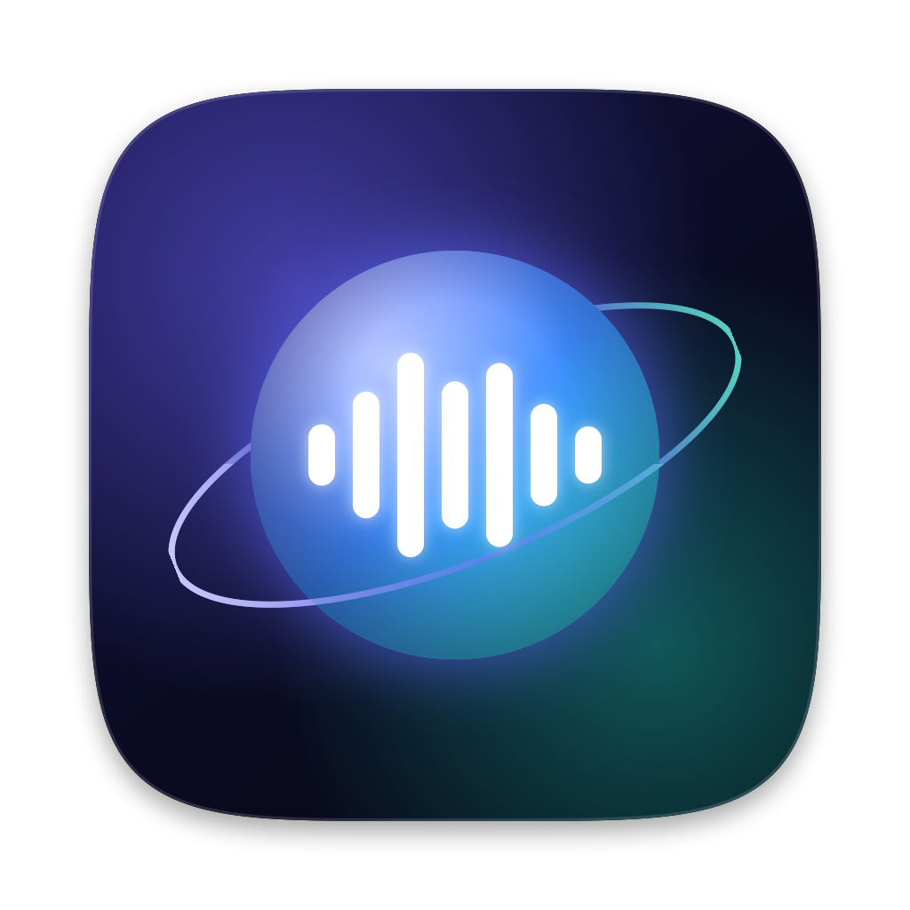
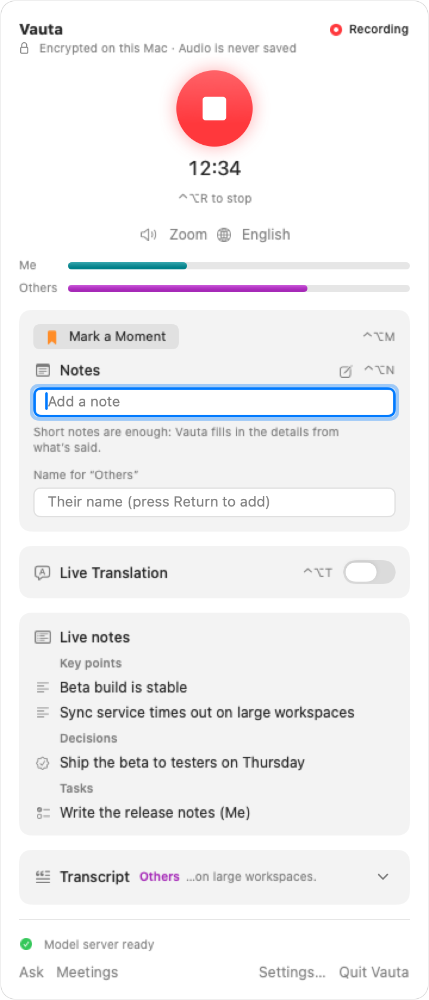
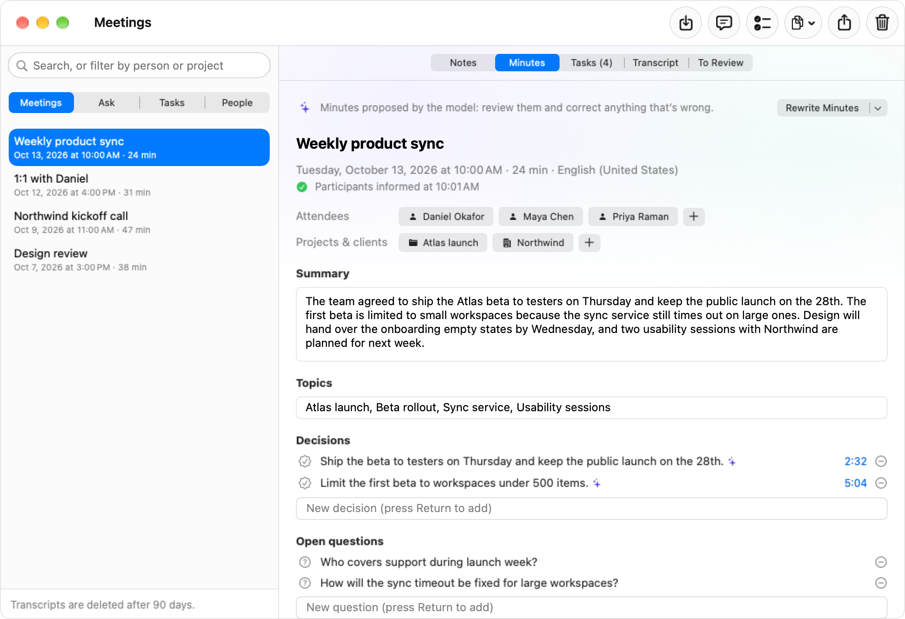
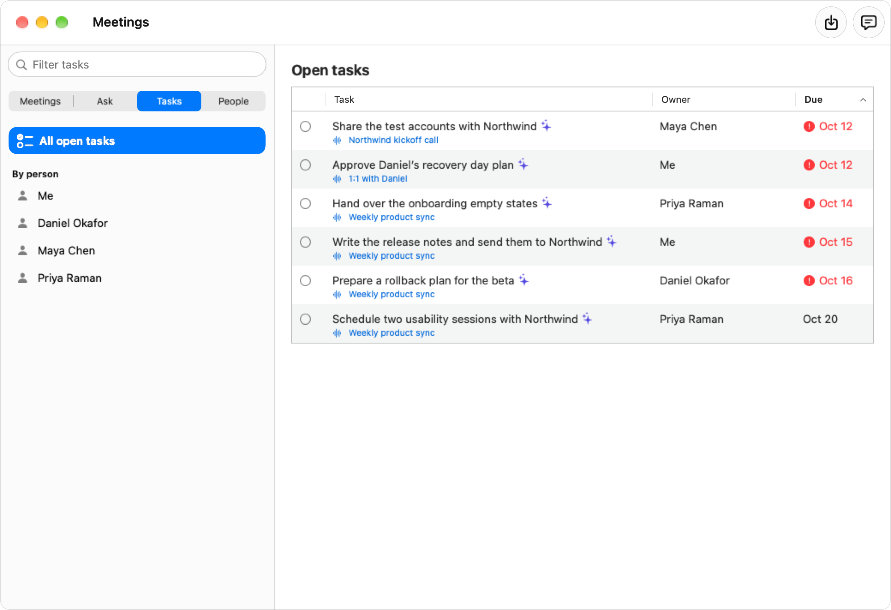
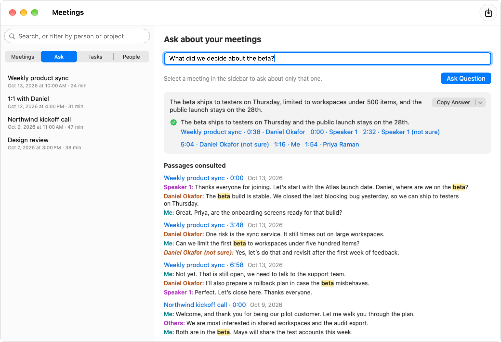
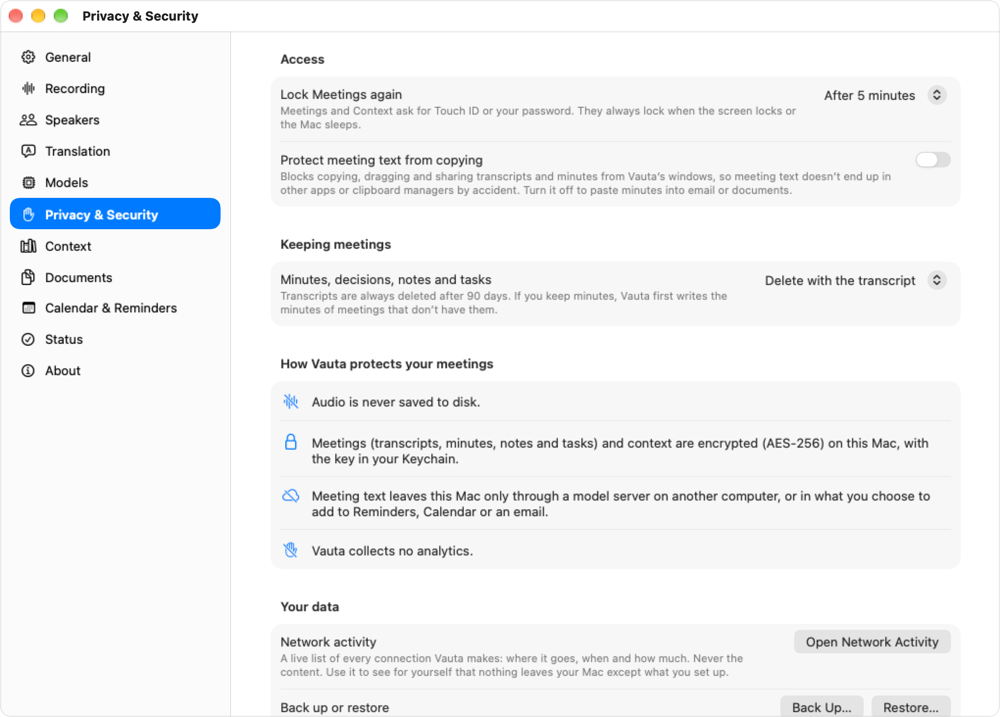

<p align="center">
  
</p>

<h1 align="center">Vauta</h1>

<p align="center">
  <strong>Your meetings, locked in your Mac.</strong><br>
  The meeting memory for Mac that stays on your Mac and your own network — any app, in person too, no bots, no accounts, auditable. Vauta transcribes your calls on device and turns them into minutes, decisions and tasks you can search and ask about.
</p>

<p align="center">
  <a href="LICENSE"></a>
  
  
</p>

<p align="center">
  English · <a href="README.es.md">Español</a>
</p>

---

Vauta is a menu-bar app for macOS. It listens to your microphone and to the app that holds the call, transcribes both on your Mac with Apple's speech recognizer, and writes the minutes with a model you choose: Apple's on-device model, or a model server you run yourself on this Mac or on your local network.

There is no Vauta cloud, no account and no bot in your calls. Audio is never saved.

Every factual claim in this README is backed by a test, a benchmark or a command you can run yourself: see [docs/CLAIMS.md](docs/CLAIMS.md). Measured accuracy (speaker separation, transcription and the citation checks of minutes, with method, hardware and limits) is in [docs/BENCHMARKS.md](docs/BENCHMARKS.md).

## Contents

- [Features](#features)
- [Privacy](#privacy)
- [Screenshots](#screenshots)
- [Requirements](#requirements)
- [Install from source](#install-from-source)
- [First run](#first-run)
- [Choosing a model](#choosing-a-model)
- [Languages](#languages)
- [Compatibility](#compatibility)
- [FAQ](#faq)
- [Troubleshooting](#troubleshooting)
- [Contributing, security and license](#contributing-security-and-license)

## Features

- **No bot joins your call.** Vauta records two channels on your Mac: your microphone as **Me** and the call audio as **Others**. Nobody else needs to install or accept anything.
- **Any meeting app or browser.** Capture Safari and other WebKit browsers, Chrome and other Chromium browsers, Firefox and other Gecko browsers, Zoom, Microsoft Teams, Slack, Discord, Webex and FaceTime (which of them are verified in real calls is in [Compatibility](#compatibility)). *Auto* follows whichever app is using the microphone, and *All system audio* is there for everything else. Vauta can also suggest recording when a meeting app starts using the microphone.
- **Any language Apple supports.** Transcription uses Apple's on-device speech models. Each meeting keeps its own language, and minutes can be written in the meeting's language or in one you choose.
- **Live Translation.** While you record, a floating captions panel shows what the other participants say, translated into your language by Apple's on-device Translation. If you have a model server, it then re-translates each finished sentence with the previous ones as context and, when it answers within 4 seconds, replaces the caption in place; otherwise Apple's version stays. It stays above full-screen meeting apps, never takes focus, and **⌃⌥T** turns it on or off. Finished sentences are kept, encrypted, with the transcript.
- **A reminder to tell the other participants.** When recording starts, the panel offers a short notice to paste into the meeting chat, written in the meeting's language, with a Copy button and "Mark as Informed" (Vauta keeps the date with the meeting; **Undo** takes it back). It never sends anything and never blocks recording. Choose when it appears in **Settings → Recording**.
- **Minutes with templates.** Summary, topics, decisions, tasks with owners and dates, and open questions. Templates for a general meeting, one-on-one, stand-up, client or sales call, interview, and class or talk. Live notes, marks and your own short notes while you record: type a bullet (in the panel or in a floating notepad that stays out of screen sharing) and Vauta writes it out from what was said, every sentence cited to the transcript and verified, with your words always first.
- **Ask, with citations.** Ask questions across all your meetings or a single one. Answers cite the passages they come from, and each citation opens the transcript at that moment. Keyword search always works. An optional search model, EmbeddingGemma 2 by Google (574 MB, downloaded only when you ask), adds search by meaning on this Mac, in any language and across languages.
- **Live answers to the questions asked in the meeting.** While you record, Vauta notices questions asked aloud, by you or by anyone else, and shows a short answer in the panel when your meeting so far, your past meetings or your documents can answer it, with the line it quotes for each claim. It works with the integrated model or a model server (not with Apple Intelligence: see below), takes no focus, makes no sound, never speaks, searches no web and sends nothing beyond the model you chose. The card shows the claims, each citing a line whose words it quotes, and an answer with a claim that could not be matched to a quote is not shown. A matching quote does not prove the claim is right: the blind judge found few shown answers correct (2% for Apple, 21% for Gemma in English) and most of the rest restating the question or answering something that was not a question, and unsupported claims in 42% (Apple) and 21% (Gemma) of the answers shown (see below). Turn it on, or choose where it looks, in **Settings → Recording → Live answers**. It starts **off** and is **not offered with Apple Intelligence**: it was measured on public meetings and 2% of the answers it showed were judged correct in English (3.63 false answers an hour against a gate of 1), so with Apple's on-device model Settings shows no switch, only a note that live answers need the integrated model or a model server, and a recording never looks for questions, whatever you chose before. The integrated model did not meet the gates either (21% judged correct against 85%, 1.60 false answers an hour) and a model server has not been measured yet (see [LANGUAGE_MODEL.md](docs/LANGUAGE_MODEL.md#live-answers-to-questions-heard-in-the-meeting)), so with those you turn it on in Settings if you want to try it.
- **Your documents as knowledge.** Add folders and files (PDF, Word, Excel, PowerPoint, Markdown, text, RTF, HTML, CSV and images, read on this Mac with on-device text recognition) in Settings → Documents. Ask answers from them too, with a verified quote and a citation that opens the file at the page (a PDF opens in the app with the quote highlighted); it works with Apple's small on-device model. The index is encrypted and kept in step with your files, your files are never changed, and document text is treated as data, never as instructions. Attach files to a single meeting as its materials.
- **People and tasks.** Vauta builds a graph of the people, projects, clients and topics in your meetings, with a list of open tasks. A glossary and recurring meetings help it recognise names and terms. With your permission, it can take titles and attendees from your calendar.
- **A brief before each meeting.** With Calendar on, Vauta can prepare a short page for the meeting about to start: who is coming, what the last meeting with them left open (decisions, open tasks and questions), related meetings, your documents and notes, and related reminders. It is built on this Mac from what Vauta already holds, and every line from Vauta’s own data opens its source (lines from the invitation are plain text). A notification a few minutes before (Off, 5, 10, 15 or 30) says only that a brief is ready. The brief is also a card in the menu-bar panel, **Upcoming** in Meetings, and a **Brief** tab on a meeting recorded with it. Reminders (only the lists you choose) and a folder of notes you export from Notes (macOS 27; macOS 26 unconfirmed) are optional. The brief itself never writes to Calendar, Reminders or Notes. The brief is on once Calendar is on, with the notification 10 minutes before (Settings → Calendar & Reminders turns it off or changes the time), and keywords rank it, not the search model. A model-written suggested agenda is off: Apple's model and the integrated model did not pass the usefulness gate (41.7% and 54.1% against 70%) and the model server's was not measured (see docs/BRIEF.md); no comparison with other products is claimed.
- **After a meeting, you decide.** **Follow Up…** (⇧⌘U) turns a meeting's open tasks into reminders in a list you choose, an agreed next meeting into a Calendar event (or a file Calendar opens, when Calendar is not already on). Each item is yours to confirm: nothing is ticked beforehand, nothing is written until you press Add, an editor shows exactly what will be written and where, Undo removes only what Vauta added, and a task is not added twice unless you choose **Add Anyway** (Vauta keeps a ledger of what it added and checks the titles in the one list it adds to; a file handed to Calendar is checked against the ledger only). A card in the menu-bar panel offers to review a meeting after its minutes are ready. Reminders asks for access the first time you press Add; Calendar is never asked: without access, Calendar opens a file and asks where to add it. See [docs/ACTIONS.md](docs/ACTIONS.md). Vauta also looks for agreed follow-up meetings in the transcript and offers at most 2 per meeting for you to confirm (on a judged test of 15 meetings whose minutes were made with the new extraction, which the app does not run yet; the app's own minutes were not measured, and with them the detector ignores tasks marked "to be confirmed". With that cap, it listed 26 of the 30 expected meetings it could; all 26 were sentences inserted into the test transcripts, every one was a real follow-up mention (the lower bound of that precision, 0.87, is under the 0.90 gate) and every day was right, but 2 of the 26 had no time where one was said; over all 103 expected meetings it found 26, and it missed both of the 2 mentions in ordinary conversation); you can always add one by hand (**New Event…**). The follow-up email draft is not available in this version: on the same test no draft met the gate of zero factual errors (see [docs/BENCHMARKS.md](docs/BENCHMARKS.md#post-meeting-actions)). A plain feature table is in [docs/ACTIONS.md](docs/ACTIONS.md#feature-table). Linking a task or decision to the same one in an earlier meeting is built but **off**: on a judged test it did not reach its precision and recall gates on Apple's model or on the integrated one, so Vauta suggests nothing of the kind (see [docs/BENCHMARKS.md](docs/BENCHMARKS.md#post-meeting-actions-part-b-links)).
- **Export and import.** Export a meeting as Markdown, plain text, PDF, SRT or WebVTT subtitles, or JSON, optionally with the stored translation. In a meeting with speakers, the exports name who said each line (an unsure label reads "(not sure)"); decisions and tasks the transcript does not back are marked as not confirmed; they never contain voice data. Copy minutes or an answer with its sources. Import an audio or video recording as a new meeting.
- **Encrypted at rest.** The meeting store is encrypted with AES-256-GCM, and the key is kept in your Keychain. The Meetings window locks behind Touch ID or your password. By default, meetings are deleted after 90 days. You can keep the minutes and what Vauta learned from them for one year, two years or with no limit; transcripts are still deleted after 90 days.
- **Your choice of model.** Apple Intelligence on this Mac with no setup, or an OpenAI-compatible model server such as LM Studio, Ollama, llama.cpp, MLX, vLLM, Jan or LocalAI. Servers running on this Mac are detected automatically.
- **Auditable.** Settings → Privacy & Security → **Open Network Activity** lists every connection Vauta makes (where, when, how much, never the content), so you can check the privacy claims yourself ([how each claim is backed](docs/CLAIMS.md#privacy-and-security)).
- **Native.** Swift and SwiftUI, Apple frameworks and the system SQLite, plus one third-party package: MLX (MIT), which runs the optional search model on the GPU. Nothing else. The two bundled speaker-separation models are weights, not code; see [NOTICE](NOTICE).

## Privacy

Vauta is built so that your meetings stay yours.

- **Audio is never written to disk.** It is transcribed in memory as it arrives and then discarded.
- **Transcription runs on your Mac** with Apple's speech framework.
- **No telemetry**, analytics or crash reporting, and no account.
- **The only network traffic** is:
  - **The model server you choose**, if you choose one. A server *on this Mac* is reached only on a loopback address. A server *on your network* is reached only over HTTPS (TLS 1.3) and only at a private address (such as `192.168.x.x`, `10.x.x.x` or a Tailscale address) or a local name (such as `*.local`). You can trust it through your own certificate authority and pin its key. Vauta uses no proxy and follows no redirects. It refuses to send anything to an address on the internet.
  - **Finding servers on this Mac**: when you look for servers during setup or in Settings, Vauta checks the usual ports on `127.0.0.1` only (1234, 11434, 8080, 8000 and 1337).
  - **Apple's model downloads.** macOS downloads the speech models, the translation languages and the assets for on-device search from Apple. Vauta does not download them itself.
- **With Apple Intelligence** chosen for minutes and search, meeting text never leaves your Mac.
- Vauta never listens for incoming connections. It runs in the App Sandbox with the hardened runtime, and can only read or write files you pick in an Open or Save dialog.

Read [PRIVACY.md](PRIVACY.md) for everything Vauta stores and where, and [SECURITY.md](SECURITY.md) for the threat model.

### Verify it yourself

You don't have to take our word for any of this.

- **Network Activity.** Go to Settings → Privacy & Security → **Open Network Activity** to see every connection Vauta itself has made since it started: the time, the purpose (minutes, live notes, expanding notes, Ask, search by meaning, search model download, translation, server discovery, connection test or status check), the destination host and port, the method and path, the approximate size of what was sent and received (body bytes only, not headers), and the result. Repeated identical probes of this Mac (such as the guided setup checking for a server) are shown as one row with a count and the time of the last one, and a request that Vauta's own rules refused before sending is listed as **Blocked** (the reason is in its tooltip, never content) and named under the summary. A discovery probe that finds no server running is shown as "Nothing running", not as a failure. A summary at the top counts the destinations, for example "Only 2 destinations, all on your Mac or your local network". The list never holds content, prompts, headers, keys or query strings, and it lives in memory only (the last 1,000 requests of this session). You can filter it (the count then reads "N of M requests"), clear it, or save it with **Export JSON…**. While a Vauta window is open, **Window → Network Activity** (⌥⌘N) opens it too.
- **No way around it.** Every request goes through one audited code path, and a test fails if any other file in the source opens a connection. Anyone can read that code: `Sources/VautaCore/Network/AuditedSession.swift`.
- **What it cannot show.** Downloads that macOS makes itself (speech recognition and translation languages, Apple Intelligence model files) are not Vauta's connections, so they are not listed.
- **Independent tools.** To check from outside Vauta, use a network monitor you trust, such as [Little Snitch](https://obdev.at/products/littlesnitch/) or [LuLu](https://objective-see.org/products/lulu.html), and watch what Vauta connects to: you should see only your model server (or `127.0.0.1`). In Terminal, `lsof -nP -i -a -c Vauta` lists Vauta's open connections at that moment.

## Screenshots

The screenshots show invented sample meetings, in light or dark to match your GitHub theme.

<p align="center">
  <picture>
    <source media="(prefers-color-scheme: dark)" srcset="docs/assets/screenshots/menubar-panel-recording-en-dark.png">
    
  </picture>
</p>

<p align="center">
  <picture>
    <source media="(prefers-color-scheme: dark)" srcset="docs/assets/screenshots/meetings-minutes-en-dark.png">
    
  </picture>
</p>

<p align="center">
  <picture>
    <source media="(prefers-color-scheme: dark)" srcset="docs/assets/screenshots/tasks-en-dark.png">
    
  </picture>
</p>

<p align="center">
  <picture>
    <source media="(prefers-color-scheme: dark)" srcset="docs/assets/screenshots/ask-en-dark.png">
    
  </picture>
</p>

<p align="center">
  <picture>
    <source media="(prefers-color-scheme: dark)" srcset="docs/assets/screenshots/settings-privacy-en-dark.png">
    
  </picture>
</p>


Vauta has three places you will use:

| Where | What it does |
|---|---|
| **Menu-bar panel** | Start and stop recording, see both audio levels, pick the audio source and language, add marks and quick notes, read live notes. |
| **Meetings window** | Read minutes and transcripts, edit them, export, and switch between Meetings, Ask, Tasks and People (⌘1–⌘4). |
| **Settings** | General, Recording, Models, Privacy & Security, Context, Calendar & Reminders, Status and About. |

## Requirements

- A Mac with **Apple silicon**.
- **macOS 26** or later.
- Free disk space for Apple's speech model of each language you transcribe. macOS downloads each one once.
- To write minutes, one of these:
  - **Apple Intelligence** turned on, on a Mac and in a language that support it, or
  - an **OpenAI-compatible model server** on this Mac or on another computer in your network. See [docs/MODEL_SERVERS.md](docs/MODEL_SERVERS.md).

Transcription works without either. Without a model, you still get transcripts but no minutes or answers.

## Install from source

Vauta is distributed as source code only. There is no download, no installer and no Homebrew package: you clone the repository and build Vauta on your own Mac. That is also how you know what you run (see [SECURITY.md](SECURITY.md#verifying-what-you-run)).

Requirements, besides those above: Git and Apple's **Command Line Tools** with the macOS 27 SDK (Swift 6.4), installed with `xcode-select --install`. Xcode is not required. A build made on your own Mac is not quarantined, so Gatekeeper does not block it.

```sh
git clone https://github.com/MaquinaTech/Vauta.git
cd Vauta

# Recommended, once: create a free local signing identity in its own locked keychain (asks for passwords).
./scripts/setup-signing.sh

# Build, install into ~/Applications and open Vauta.
./scripts/install.sh
```

Vauta appears in the menu bar. While one of its windows (Meetings, Settings, Setup) is open it also shows in the Dock and ⌘Tab, with its full menu bar; when the last window closes it returns to the menu bar only.

**Why `setup-signing.sh`.** It creates a self-signed certificate that exists only on your Mac, in a dedicated keychain protected by its own password. With that stable signature macOS recognizes each rebuild as the same app, so it keeps Vauta's microphone, system-audio, Calendar and Reminders permissions and its Keychain access across updates. It costs nothing and needs no Apple Developer account.

**Quick alternative: ad-hoc signature.** To skip the signing setup:

```sh
VAUTA_ALLOW_ADHOC=1 ./scripts/install.sh
```

The trade-off: every rebuild looks like a new app to macOS, so it asks for the permissions again after every update.

The first time the app opens, macOS asks for your Keychain password for "Vauta". Choose **Always Allow**. It asks again after every update of an ad-hoc build, and after you create a new signing identity: choose **Always Allow** then too. If the prompt appears when you have not just installed or updated Vauta, choose **Deny**.

**Permissions.** During setup macOS asks for the **microphone** (your voice), **system audio** (the other participants in the call) and, if you turn those features on, **Calendar** (meeting titles and attendees), **Reminders** (to send tasks there) and notifications. Vauta also asks for access to your **local network** if you point it at a model server on another computer. Each one can be changed later in System Settings → Privacy & Security.

**Update.** Run the update script; it installs the newest release only if its tag is signed by the maintainer's key, shows the release notes and asks first. Vauta quits cleanly, replaces itself and reopens:

```sh
cd Vauta
./scripts/update.sh                         # with the local signing identity, in your own Terminal
VAUTA_ALLOW_ADHOC=1 ./scripts/update.sh     # with the ad-hoc signature
```

It checks the key against the `.github/allowed_signers` you already have (and the fingerprint in [SECURITY.md](SECURITY.md#verifying-what-you-run)), refuses an older version than the one installed, runs the tests and leaves this folder at the release tag (`git switch main` goes back to the branch). Versions before 0.9.3 don't have the script yet: run `git pull` once, then `./scripts/update.sh`.

**Uninstall.** Quit Vauta and delete `~/Applications/Vauta.app`. Your meetings live in the app's container, `~/Library/Containers/<bundle-id>/` (default bundle ID `local.vauta.app`); deleting that folder deletes all meetings, so back them up first if you want them (**Settings → Privacy & Security → Back Up…**). Then delete the Keychain items whose service is the bundle ID in Keychain Access. If you used `setup-signing.sh`, you can also delete the keychain `~/Library/Keychains/vauta-signing.keychain-db`.

The bundle ID (default `local.vauta.app`) is Vauta's identity for macOS: permissions, Keychain items and the sandbox container all hang on it. To use your own, set `VAUTA_BUNDLE_ID` in `scripts/local.env` *before* the first install. Changing it later starts Vauta from scratch, and a build with a different bundle ID is a separate app with its own data. To move data between two bundle IDs (for example from `local.vauta.app` to your own), use **Settings → Privacy & Security → Back Up…** in the old app and **Restore…** in the new one.

If you ran an earlier version of the app (bundle ID `local.acta.app`), build Vauta with `VAUTA_BUNDLE_ID=local.acta.app` to keep using the same container and Keychain items. On first launch Vauta renames the old `acta.*` store files (and the `Acta` folder) to `vauta.*` in place, after checking that your Keychain key opens them, and deletes nothing. Backups made by the earlier version (`.actabackup`) restore as they are; new ones are `.vautabackup`.

### Moving to a new Mac

Vauta's data is excluded from Time Machine on purpose, and a different bundle ID is a different app with its own data and Keychain items. To move, use an encrypted backup:

1. In the old install, open **Settings → Privacy & Security → Back Up…**, choose a password of at least 12 characters and save the file.
2. Build and install Vauta on the new Mac (or with the new bundle ID), open it once and finish the setup.
3. Open **Settings → Privacy & Security → Restore…**, choose the file, enter the password and confirm.

The backup holds your meetings, your context and your settings (languages, templates, shortcuts, privacy and recording options, and whether minutes are written by Apple Intelligence or a model server). The model server itself (its address, models and key) is not included; it stays in the Keychain of the old Mac, so set it up again. Backups made before settings were included restore the meetings and context only and leave your settings as they are. Builds before 0.9.0 have no **Back Up…** button: update the old install to a current source build **with its old bundle ID** first (see [AGENTS.md](AGENTS.md#moving-an-existing-install-to-another-bundle-id)).

## First run

1. **Setup.** A short setup window opens the first time:
   - **Languages**: the language people speak in your meetings, and the language for minutes.
   - **Permissions**: microphone (your voice, as *Me*), system audio (the other participants, as *Others*) and, optionally, notifications. While the microphone has not been asked for, **Allow Microphone and Continue** shows the system prompt first. A five-second microphone test shows that Vauta hears you; nothing is recorded.
   - **Speech model**: downloads Apple's model for your language, once. **Download and Continue** starts the download, which goes on while you set up the rest.
   - **Minutes**: *Quick start · Basic quality* (Apple Intelligence), or **Set Up a Model Server**, a guide that shows what to install and which model fits your Mac. You can skip this and set it up later in **Settings → Models**.
2. **Pick the audio source.** **Auto** (the default on a new install) follows the app in the call. In the menu-bar panel you can choose the apps you use for meetings instead, or all system audio.
3. **Record.** Join your call and press **⌃⌥R**, or click **Start Recording** in the menu-bar panel. While recording, press **⌃⌥M** to mark a moment, **⌃⌥T** to show your translated captions, type quick notes, and tell Vauta who "Others" are.
4. **Stop.** Press **⌃⌥R** again. Vauta also stops by itself after a few minutes with no audio from the other side (5 by default).
5. **Read the minutes.** Vauta writes them in the background and sends a notification when they are ready. Open **Meetings…** from the panel and unlock with Touch ID or your password.

Both shortcuts can be changed in **Settings → General**.

## Choosing a model

| Option | Setup | Good for |
|---|---|---|
| **Apple Intelligence on this Mac** (*Quick start · Basic quality*) | None, if Apple Intelligence is on | Getting started. Fully private. It reads only a short part of a meeting at a time, so long meetings are summarized in parts and minutes are shorter and less reliable. |
| **A model server on this Mac** | **Settings → Models → Set Up…** guides you through LM Studio or Ollama and the model that fits your Mac's memory | Better minutes with larger models, still on this Mac. Needs 16 GB of memory or more. |
| **A model server on your network** | A server on another computer, reached over HTTPS | A small Mac, with a bigger computer elsewhere at home or in the office. |

We do not quote minute-quality or search scores here: the early comparisons we ran used data that is not in this repository, so nobody else can reproduce them. What we can say is the direction of the design: Apple's on-device model has a small context window, so long meetings are summarized in parts, and a larger model on a server usually writes better minutes. Try both on your own meetings; switching is one setting. Keyword search for Ask needs no model at all. The accuracy figures we *can* reproduce are in [docs/BENCHMARKS.md](docs/BENCHMARKS.md).

For better minutes, use a model server with a 9B or larger model. The **Set Up a Model Server** guide (in setup, in **Settings → Models** and from the recommendation shown next to minutes written on-device) recommends LM Studio or Ollama and a model for your Mac's memory: Qwen3.5-9B from 16 GB, Qwen3.8-27B from 32 GB, nothing below 16 GB. Vauta runs no chat model engine and downloads no chat model itself; it opens the app's website, shows the commands to copy, and detects the server on this Mac. The one thing Vauta can download is the optional search model below, and only when you click Download.

Ask uses keyword search until you turn on search by meaning. The **Ask finds passages with** setting (Settings → Models) can be **Search by meaning on this Mac**, **Search by meaning (model server)** or **Keyword search**.

**Search by meaning on this Mac** needs the search model: EmbeddingGemma 2 by Google, 574 MB, Apple silicon only. It is optional and never downloaded on its own. In Settings → Models, **Download** fetches only its text part from Hugging Face (the download is listed in Network Activity as "Search model download"), checks every piece against checksums built into Vauta, and keeps it in Vauta's own folder, outside backups and removable with **Delete…**. If you already have the files, **Import from a File…** checks them the same way. Once your meetings and documents are indexed, it finds passages by meaning in any language and across languages (a question in English finds the Spanish passage), and exact names, numbers and codes still count. Until then, and without the model, Ask uses keyword search; the label under the question says which. Everything runs on this Mac and your meetings and documents never leave it. How it is pinned, verified and ranked: [docs/SEARCH_MODEL.md](docs/SEARCH_MODEL.md).

### The integrated model (optional)

On a Mac with 16 GB of memory or more, Settings → Models offers a third way to write minutes on this Mac: **Integrated model (Gemma 4 E4B, Google)**. It is optional, it is never the default and it is not recommended over the other options: it is a large download (about 15 GB, of which about 4.2 GB stay on your Mac), and Apple Intelligence and your model servers keep working exactly as before.

- **Only when you ask.** Nothing is downloaded until you click **Download** (or **Import from a File…**, which makes no connection). Vauta fetches only the text part of Google's `google/gemma-4-E4B-it` at one pinned revision from Hugging Face, checks every 64 MB block against checksums built into Vauta, converts it on your Mac to a 4-bit model and checks the result; the 15 GB original is never stored. The download is listed in Network Activity as "Language model download". It pauses while you record and for two minutes after, can be paused and resumed, and a damaged install is repaired by fetching only the damaged part.
- **What it does.** It reads a whole meeting at once, so a long meeting is summarized in one pass, and it writes the minutes, the live notes and the answers on this Mac. While you record it reads the transcript as it goes (the part already read is kept in memory only), so the minutes can start within seconds when the meeting ends, as long as the lines it read do not change afterwards. When the final voice analysis splits a segment, the model reads again from the first line that changed, which for a long meeting can take over a minute (renumbering speakers alone no longer changes a line). You can leave the live notes and questions during a meeting to Apple Intelligence (**While recording**), which keeps the integrated model idle until the meeting ends, so the minutes take longer to start.
- **What it checks.** Every decision, task and answer cites the transcript and must quote it word for word, ignoring case, punctuation, spacing and filler words such as "uh" and "um". An answer none of whose quotes can be found is shown as **Not verified**. A question about something that has not been said yet in a meeting you are recording may still be answered from related remarks (the answer then needs quotes that check out); a "That hasn't come up yet in this meeting" reply exists but is off by default because it did not pass its test.
- **Where it runs.** On this Mac's GPU, with Apple's MLX. Your meetings are never sent anywhere. See [docs/LANGUAGE_MODEL.md](docs/LANGUAGE_MODEL.md) and [PRIVACY.md](PRIVACY.md).

See [docs/MODEL_SERVERS.md](docs/MODEL_SERVERS.md) for setup guides, recommended models and troubleshooting.

## Languages

- **Interface**: English, Spanish, French, German, Italian, Brazilian Portuguese, Japanese, Korean and Simplified Chinese. Vauta follows your Mac's language; to change it for Vauta alone, use **System Settings → General → Language & Region → Applications**.
- **Transcription**: every language Apple's speech recognizer supports on your version of macOS, with Apple's dictation models as a fallback for languages it doesn't. The list depends on macOS; **Settings → Recording** shows it, and so does `Vauta languages`. On English AMI meeting recordings the word error rate was 10.8% on close-talk headsets and 20.3% on a simulated remote mix with overlapping speakers, measured with the audio muted outside each speaker's turns so that speech detection is not scored (63% and 54% without that muting) ([method and limits](docs/BENCHMARKS.md#word-error-rate)); in Spanish, on read and parliament speech (not conversation), it was 7.6% ([Spanish](docs/BENCHMARKS.md#spanish)); other languages were not measured. macOS limits how many speech languages an app can reserve at once; Vauta releases the least recently used one when needed.
- **Minutes and answers**: in the meeting's language or a language you choose. Ask answers in the language of your question.
- **Live Translation**: the languages Apple's Translation framework offers (about 20 languages, some with regional variants). It translates from the meeting's transcription language into the language you pick in **Settings → Translation** (by default, the first of your Mac's languages that differs from the meeting's). Each pair is downloaded from Apple once, with the system's own consent sheet; macOS manages (and removes) them in **System Settings → General → Language & Region → Translation Languages**. See [docs/COMPATIBILITY.md](docs/COMPATIBILITY.md#live-translation).
  - **Better translations with your model server.** Apple translates every caption on this Mac at once. With a model server set up, **Settings → Translation → Improve finished sentences with your model server** (on by default) sends each *finished* sentence of the other participants, with the three before it, to your server, which translates it again knowing the context. If its answer arrives within 4 seconds it replaces the caption with a soft cross-fade and is the version saved with the transcript; on a timeout, an error or no server, Apple's translation stays, with a small indicator in the captions bar and no alert. The server's fast model is used (Qwen3.5-9B recommended) unless you choose another **Translation model**, and **Test** translates a sample sentence and shows the real latency. Whether your server's version is better for your languages is yours to judge: **Test** shows the real latency, and Apple's translation always stays as the fallback. Nothing goes anywhere but your model server.

Want to help translate? See [docs/TRANSLATING.md](docs/TRANSLATING.md).

## Compatibility

Vauta captures "Others" with a Core Audio process tap on the meeting app's processes. Safari has been tested in real calls; the other apps and browsers are expected to work but still need confirming. See [docs/COMPATIBILITY.md](docs/COMPATIBILITY.md) for the full list, and how to check an app and report the result.

If a meeting app is using your microphone but nothing has reached **Others** for a minute while recording, the panel tells you (once per silent stretch), says what to check (the app's sound is muted or goes to a device Vauta does not capture, or the system-audio permission) and lets you dismiss it ([test](docs/CLAIMS.md#capture-and-transcription)).

## FAQ

**Is audio stored anywhere?**
No. Audio is transcribed in memory and discarded. Only the text is kept, in the encrypted store.

**Does anything go to the cloud?**
Only if you point Vauta at a server yourself, and even then Vauta only accepts a server on this Mac or on your local network. With Apple Intelligence, nothing leaves your Mac. Speech models come from Apple, downloaded by macOS.

**How can I check that Vauta sends nothing else?**
Click **Open Network Activity** in Settings → Privacy & Security, and watch it while you use Vauta. For an independent check, use a network monitor such as Little Snitch or LuLu. See [Verify it yourself](#verify-it-yourself).

**Does Vauta join my calls as a bot?**
No. It never joins, and other participants see nothing. It hears what your Mac hears.

**Do I need to tell the other participants?**
Yes. Running on your Mac does not remove the duty to tell people they are being transcribed: privacy laws such as the GDPR can require it, and some places (two-party or all-party consent jurisdictions) require everyone's consent. Vauta helps: when you start recording, the panel offers a ready-to-paste notice in the meeting's language, and records when you marked the participants as informed. It never sends the notice for you and never blocks recording. This is not legal advice; follow the law where you and they are.

**Does it tell who is speaking?**
Yes. It separates you (*Me*) from everyone else (*Others*), and tells the other participants apart as *Speaker 1*, *Speaker 2*… with two small models bundled in the app. This happens on your Mac and keeps no audio and, unless you turn on recognizing voices (next question), no voice between meetings. It is on by default and can be turned off for all meetings in **Settings → Speakers** and for a single meeting with **Don’t separate speakers in this meeting** in its Transcript. The transcript shows each speaker’s name, **Who spoke** in the minutes shows how long each one talked, and you can name a speaker, merge two, or fix who said a line (every change can be undone from the Edit menu). While recording, the panel and the captions show provisional speaker labels (names may change when the meeting ends), and you can name each voice there. The minutes use it too: task owners come from who said the line, and a decision or task the transcript does not back (names, dates or figures that do not match the passage it cites, or an item less certain than the main ones of the meeting) is marked **Unconfirmed**. Calendar attendees are only suggested, never assigned for you. It is not perfect: similar voices can be merged and crosstalk is hard. On public English meeting recordings made to resemble the remote side of a call, about 9% to 10% of speech time was missed, wrongly detected as speech or given to the wrong speaker: a diarization error rate of 9.4% over the 18 recordings the settings were tuned on, and 9.5% over 19 further recordings they were not tuned on (settings not chosen on them, though their figures were seen during the sweeps) (15.1% and 15.8% if every turn boundary is judged strictly), scoring only the remote speakers' time, so that the test audio's leak of your own voice does not count (with the plain scoring region it is 26.3% for the 18, and 38.1% for their AMI recordings; see [the scoring region](docs/BENCHMARKS.md#the-no-bleed-scoring-region)), against 41% for the 18 (55% for the AMI and 53% for the VoxConverse recordings of the 19) if everyone were treated as one speaker. It found the exact number of speakers in 9 of the 18 and was off by at most one in all 18, and in 9 and 18 of the 19; on those 19 it finds slightly too many speakers on average (+0.6). On 12 synthetic Spanish conversations (six built from audiobook readings and six from parliament speech, easier than a real meeting) the rate was 7.2%; with simulated call impairments (noise, packet loss, narrowband) added to English and Spanish files it was 16.3%. Method, per-file results and limits are in [docs/BENCHMARKS.md](docs/BENCHMARKS.md#diarization-error-rate); real Spanish meetings, other languages and real calls were not measured. See [PRIVACY.md](PRIVACY.md#speaker-separation).

**Can it recognize people’s voices across meetings?**
Only if you turn it on. **Settings → Speakers → Recognize voices across meetings** is off by default. When it is on, you can choose **Remember This Voice** for a speaker you named, and later meetings can suggest that person for a voice that resembles it (“Is this Ana?”, with Yes and No). A saved voice never names anyone by itself: a speaker has a name only when you give it or accept the suggestion. A voice is saved only by your action, one person at a time, after you confirm that the person agreed; you are responsible for that agreement, and organisations should mention it in their data protection impact assessment. What is saved is a fingerprint (a list of numbers, not a recording) in the encrypted store: it is in encrypted backups and removed by Erase Everything, and never in exports, logs, prompts, search or the network. You can delete one person’s voice (Settings → Speakers, or their card) or all of them. **This Is My Voice** saves your own, so later imported recordings can suggest which speaker is you; nothing moves to *Me* by itself. It was only tested on English recordings with headsets: with other languages, laptop microphones or phone audio it can miss people or suggest the wrong person more often, and it can confuse similar voices. In recordings, a saved person is often not suggested and is sometimes suggested as another saved person; the more voices you save, the more likely an unknown speaker resembles one of them. That is why a suggestion is only a question until you answer Yes. Your own choice always wins. See [PRIVACY.md](PRIVACY.md#voice-data).

**Can I use it for in-person meetings?**
Yes. Everything the microphone picks up is transcribed as *Me*.

**How do I delete my data?**
Delete single meetings in the Meetings window, or erase meetings and context in **Settings → Privacy & Security**.

**Can I back up my meetings?**
Yes: **Settings → Privacy & Security → Back Up…** saves everything to one file encrypted with a password you choose. Keep the password: Vauta cannot recover it.

## Troubleshooting

**Settings → Status** lists what is missing, with a button to fix each item. From Terminal, `doctor` checks the speech models, the model server and permissions without opening your meetings:

```sh
~/Applications/Vauta.app/Contents/MacOS/Vauta doctor
```

`Vauta help` lists all commands.

## Contributing, security and license

- **Contributing**: see [CONTRIBUTING.md](CONTRIBUTING.md) and the [Code of Conduct](CODE_OF_CONDUCT.md).
- **Help**: see [SUPPORT.md](SUPPORT.md).
- **Security**: please report vulnerabilities privately, as described in [SECURITY.md](SECURITY.md).
- **Privacy**: [PRIVACY.md](PRIVACY.md).
- **Changes and plans**: [CHANGELOG.md](CHANGELOG.md) and [docs/ROADMAP.md](docs/ROADMAP.md).
- **How it works**: [docs/ARCHITECTURE.md](docs/ARCHITECTURE.md).

Vauta is licensed under the [Apache License 2.0](LICENSE). See [NOTICE](NOTICE).

Apple, macOS, Safari, FaceTime and Apple Intelligence are trademarks of Apple Inc. Other product names are trademarks of their owners. Vauta is not affiliated with any of them.

## Credits

Created by Nicolás López de Lerma López.
